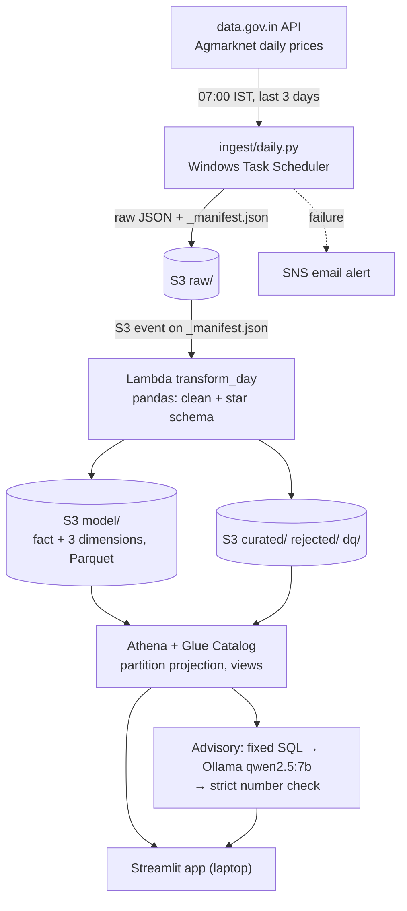
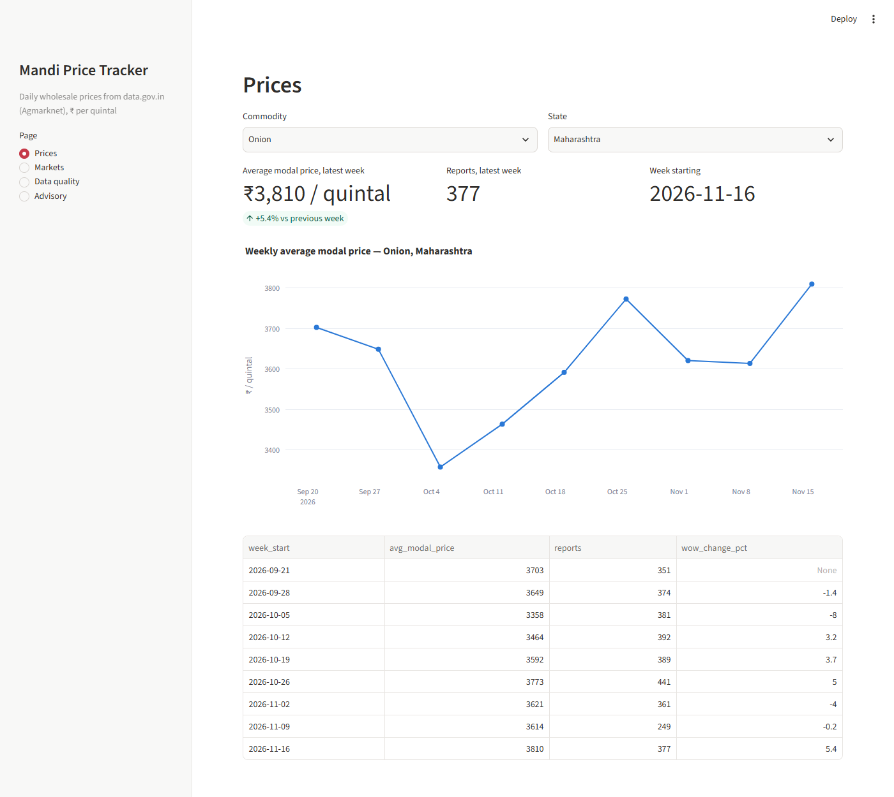
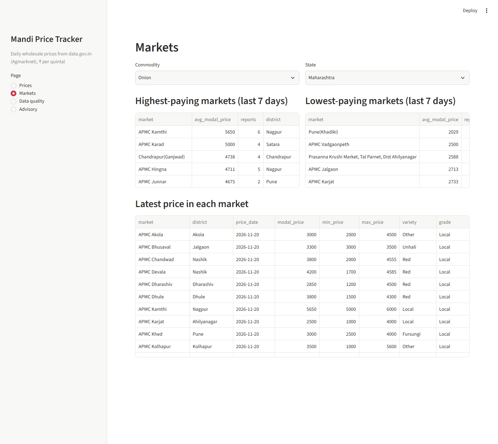
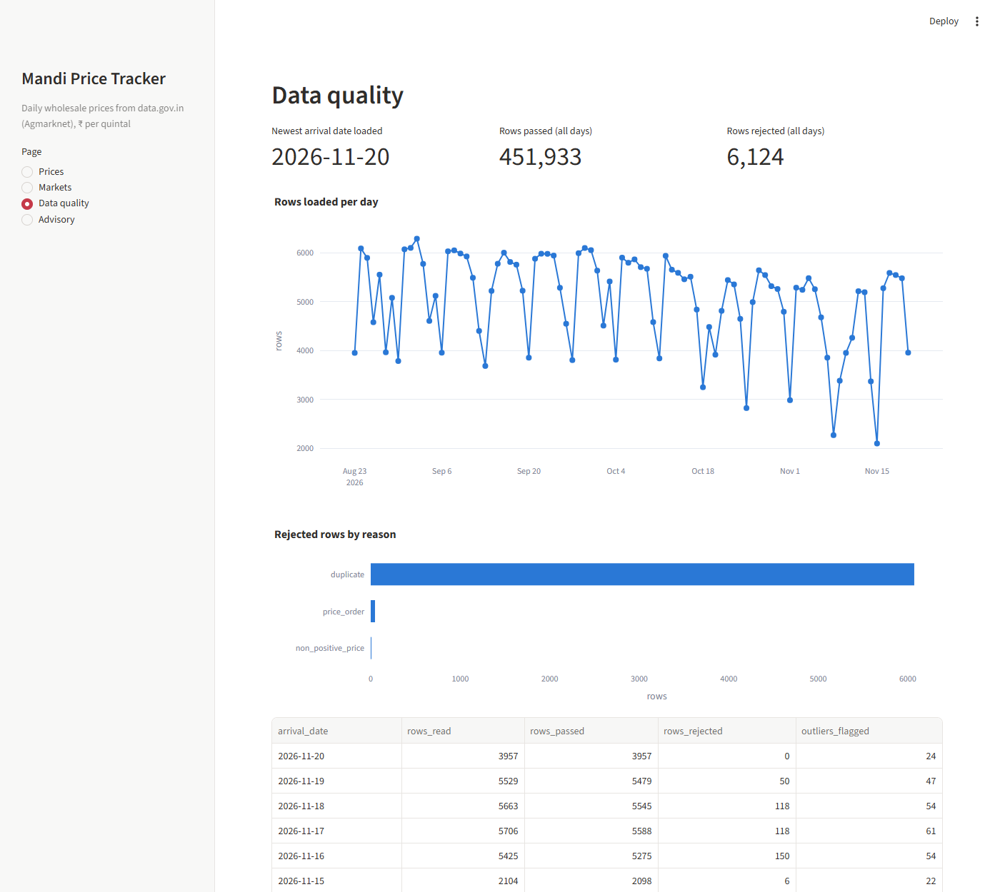
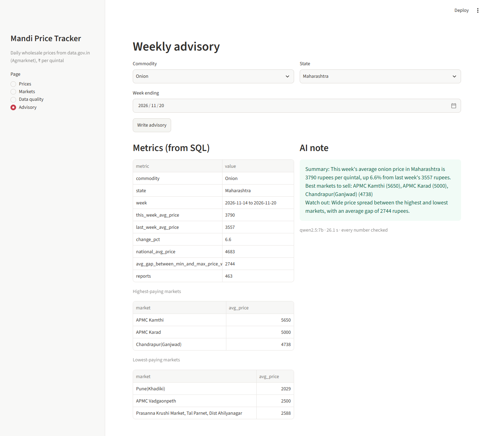

# Mandi Price Tracker

A small daily data pipeline on AWS that pulls India's official mandi (wholesale market) prices from data.gov.in,
cleans them with pandas, stores them as a Parquet star schema on S3, answers price questions with Athena SQL,
and writes a short weekly price advisory with a local LLM — where every number is checked against the SQL.

## The problem

India has thousands of mandis, and the price of the same crop differs between markets and changes daily.
A farmer or small trader deciding where to sell onions this week cannot easily see which nearby market pays most,
whether prices are rising, or how unstable they are. The government publishes the data daily, but as millions of
raw rows with typos, duplicates and inconsistent names.

**Users:** a small trader or farmer-producer organisation (where to sell this week) and an agri analyst
(trends and price gaps between states). **Scope:** 10 everyday commodities, all states, last 90 days + daily loads.

## Architecture



| Layer | What | Where |
| --- | --- | --- |
| Ingestion | API client with retries; 3-day re-fetch for late data; idempotent writes | `ingest/` |
| Transformation | 6 data-quality rules, rejected rows kept with a reason, outliers flagged | `transform/rules.py`, `clean_day.py` |
| Storage | Star schema: `fact_price_report`, `dim_date`, `dim_market`, `dim_commodity` (hash keys) | `transform/build_model.py`, `docs/warehouse_design.md` |
| SQL analytics | 7 business questions, 3 views, validation checks | `sql/` |
| GenAI | Weekly advisory written from verified numbers only | `genai/` |

Why the daily ingest runs on the laptop: data.gov.in refuses connections from AWS, and the Free plan cannot use
the Mumbai region — see [docs/aws_setup.md](docs/aws_setup.md).

## Run it locally (free)

```bash
python -m venv .venv && source .venv/Scripts/activate      # Windows Git Bash
pip install -r requirements.txt
cp .env.example .env                                        # fill in DATA_GOV_API_KEY
python -m ingest.backfill --days 90                         # raw JSON into data/raw (~30 min)
python -m transform.run_local --all                         # clean + star schema into data/
python -m tools.query_local sql/checks/orphan_keys.sql      # any SQL file, via DuckDB
ollama pull qwen2.5:7b
python -m genai.advisory Onion Maharashtra
streamlit run app/streamlit_app.py                          # SOURCE=local by default
python -m unittest discover tests
```

## Deploy to AWS

```bash
BUCKET=<bucket> ALERT_EMAIL=<you> ./infra/setup_aws.sh      # bucket, lifecycle rules, SNS topic
aws s3 sync data/raw s3://<bucket>/raw/                     # upload the backfill
BUCKET=<bucket> ./infra/setup_transform.sh                  # transform Lambda, S3 trigger, Athena workgroup
python -m tools.run_athena sql/athena_ddl/*.sql             # tables (S3_BUCKET in .env)
python -m tools.run_athena --views                          # views for the app
powershell -ExecutionPolicy Bypass -File infra\register_daily_task.ps1   # 07:00 daily ingest
SOURCE=athena streamlit run app/streamlit_app.py
```

## Results

| Area | Result |
| --- | --- |
| Backfill | 90 days (23 Aug – 20 Nov 2026), 900 API calls, 0 failed |
| Daily ingest | Task Scheduler run on 21 Nov succeeded and its manifests triggered the transform automatically; unattended 07:00 runs start 22 Nov (5-day target not yet shown) |
| Late data | Indirect so far: Friday 20 Nov had 17,121 records the next day vs 21,674 for Friday 13 Nov; day-over-day growth not yet recorded |
| Model | 451,933 fact rows, 2,708 markets, 757 commodity/variety/grade combinations |
| Data quality | 6,124 rows rejected with a reason (6,073 duplicates, 48 price order, 3 non-positive); outliers flagged, not dropped |
| Checks | 0 orphan keys, 0 duplicate keys, 0 bad prices — locally and on Athena |
| Local vs AWS | Athena counts match the local run for all 90 days |
| Performance | Partition pruning: a 7-day query scans 0.78 MB instead of 8.67 MB (11×) |
| SQL | Q1–Q7 run on Athena; one result hand-checked against raw JSON — [docs/results](docs/results/README.md) |
| GenAI | 5 advisories hand-checked: 3 fully traceable, 2 blocked by the number check — [docs/genai_eval.md](docs/genai_eval.md) |
| Alerts | Forced failure (wrong API key) sent an SNS email |
| Tests | 27 unit tests, run by GitHub Actions on every push |

## Screenshots

| Prices | Markets |
| --- | --- |
|  |  |
| **Data quality** | **Advisory** |
|  |  |

## Limitations and future work

- The daily ingest depends on the laptop being on (a missed run is caught up by the next 3-day re-fetch).
- 10 commodities and 90 days; full history and all ~300 commodities are future work.
- Dimensions are SCD Type 1 — a renamed market would get a new key.
- The LLM sometimes misreads small percentages (0.6% → 6%) and misdescribes the spread; the number check
  blocks the first, not the second.
- No forecasting; no hosted app.

More detail: [warehouse design](docs/warehouse_design.md) · [design decisions](docs/decisions.md) ·
[API notes](docs/api_notes.md) · [data profile](docs/data_profile.md) · [changelog](CHANGELOG.md)
