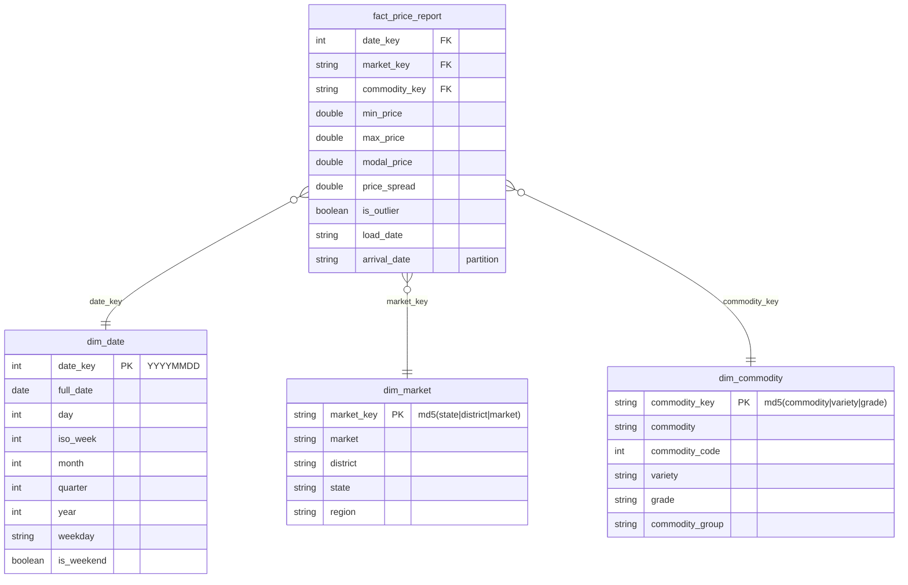

# Warehouse design

A star schema stored as Parquet on S3 and queried with Athena (DuckDB locally).

## Tables and grain

| Table | Type | One row = |
| --- | --- | --- |
| `fact_price_report` | transaction fact | one price report: date × market × commodity × variety × grade |
| `dim_date` | date dimension | one calendar day (2023–2027, generated once) |
| `dim_market` | geography dimension | one market; hierarchy market → district → state → region |
| `dim_commodity` | product dimension | one commodity + variety + grade |

Variety and grade live in `dim_commodity`, so the fact needs only three keys and its grain is still unique:
`(date_key, market_key, commodity_key)` is the natural key of the fact. The cleaning step guarantees this by
keeping one row per natural key (`duplicate` rule, see `data_profile.md`).

`region` (North, South, East, West, Central, North-East) is a fixed state → region lookup in `config/regions.yml`.

## Decisions

- **Measures are non-additive.** `min_price`, `max_price`, `modal_price` and `price_spread` are averaged
  (or min/max-ed), never summed. The count of reports is the only additive measure (`count(*)`).
- **Hash surrogate keys.** `market_key = md5(state|district|market)`, `commodity_key = md5(commodity|variety|grade)`.
  The same natural key always gives the same key in every run and on every machine, so dimensions and facts
  can be built per day independently, with no sequence table or lookup service. A database identity column
  would need a central counter and a lookup on every load. `date_key` is the readable integer `YYYYMMDD`.
- **SCD Type 1.** Dimensions are upserted from each day's data: new members are added, existing ones kept.
  There are no changing attributes to track today. If a market were renamed, the hash would give it a new key
  and history would split; handling that properly needs SCD Type 2 (valid_from / valid_to, current flag),
  which is out of scope.
- **Partition by `arrival_date`** (`model/fact_price_report/arrival_date=YYYY-MM-DD/`). Reloading a day
  rewrites exactly one folder, so loads are idempotent, and Athena scans only the days a query filters on.
  Dimensions are small and unpartitioned.
- **Outliers stay in the fact** with `is_outlier = true`; analytics queries exclude them with `NOT is_outlier`.
- **`load_date`** records when the row was loaded, so a re-fetched day (late data) is visible.

## Question → table mapping

| # | Question | Tables |
| --- | --- | --- |
| Q1 | Week-over-week average modal price per commodity and state | fact + dim_commodity + dim_market + dim_date (`iso_week`) |
| Q2 | Cheapest / costliest markets per commodity per state this week | fact + dim_market + dim_commodity |
| Q3 | Latest price in each market | fact + dim_market + dim_commodity (newest `date_key` per market) |
| Q4 | 7-day rolling average and volatility | fact + dim_commodity + dim_date |
| Q5 | State price vs national average | fact + dim_market + dim_commodity |
| Q6 | Missed reporting days per market | dim_date (spine) × dim_market, left join fact |
| Q7 | Widest price spread inside markets | fact (`price_spread`) + dim_commodity |
